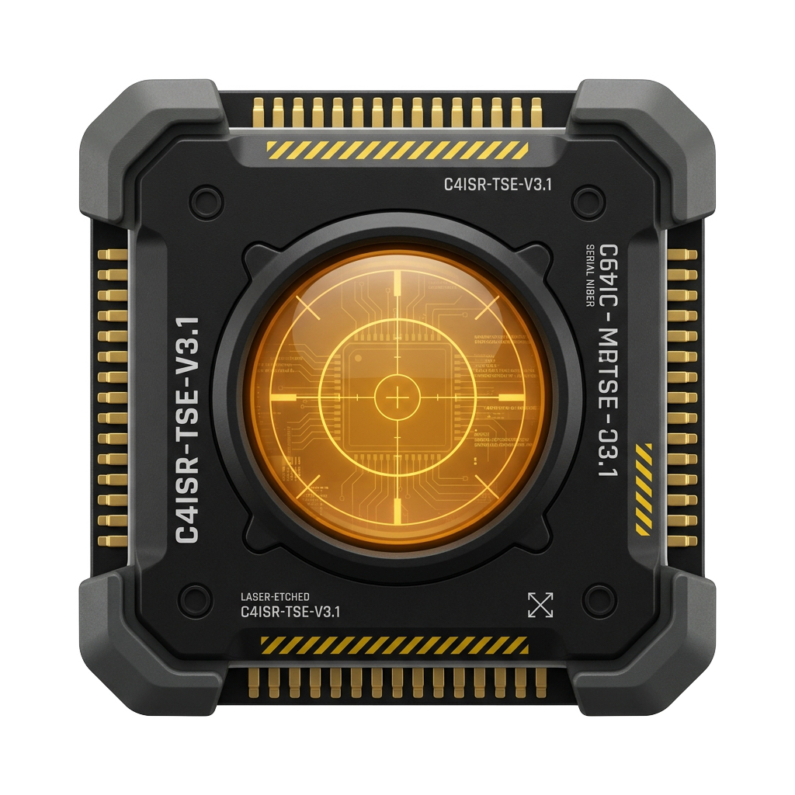

# Arma 3 SQF Review Plugin

<p align="center">
  
</p>

<p align="center">
  <strong>Equipo de agentes de IA y arnés determinista para desarrollo, auditoría de localidad multijugador, rendimiento y mejores prácticas en scripts SQF de Arma 3.</strong>
</p>

<p align="center">
  
  
  
  
</p>

<p align="center">
  <strong>Evidencia de calidad (Antigravity / gemini-3.8-flash-high):</strong><br>
  <strong>Bloque 1 (Señalizado, 14 goldens):</strong> M1 (script) 100 % &nbsp;·&nbsp; M2 (archivo) 83,3 % (mín 75,0 %) <em>NO PASA OBJETIVO</em> &nbsp;·&nbsp; M3 (pegado) 38/39 = 97,4 % <em>NO PASA OBJETIVO</em> (0 falsos PASA)<br>
  <strong>Bloque 2 (Ciego / No señalizado, 6 goldens):</strong> M2 (archivo) 100 % (12/12) &nbsp;·&nbsp; M3 (pegado) 21/21 = 100 % (0 falsos PASA, honestidad verificada)<br>
  <em>Total: 120 trazas reales reproducibles (20 goldens × 2 modos × 3 reps) evaluadas en <code>docs/QUALITY.md</code> &nbsp;·&nbsp; resto de hosts: <code>NO VERIFICADO</code></em>
</p>

---

## 🎯 Descripción General

`arma3-sqf-skill` es una **skill portable** (derivada del plugin `arma3-sqf-review` de Antigravity) diseñada específicamente para creadores de misiones y desarrolladores de mods/addons en **Arma 3**. Se adapta a Claude Code/Desktop, Cursor, OpenAI Codex, ChatGPT Custom GPTs, Gemini y Antigravity.

Desarrollar para Arma 3 en servidores dedicados (`Arma3Server`) presenta desafíos técnicos únicos: localidad de argumentos y efectos (`AL`/`AG`/`EL`/`EG`), jugadores que se unen en progreso (`JIP`), suspensión en contextos no programados (*unscheduled*), orden de inicialización y sincronización de red vía `remoteExec` y `publicVariable`. 

Este plugin implementa un **equipo colegiado de 11 subagentes especializados** guiados por un motor determinista en Python, asegurando que el código producido o auditado sea robusto, eficiente, respetuoso del scheduler y libre de fugas de variables o bloqueos de inicialización.

---

## 🏛️ Arquitectura de Ejecución

El plugin opera bajo el principio **"El script es la puerta, la prosa es el flujo"**:
- **La prosa (`SKILL.md`)** gobierna el flujo conversacional y el ciclo de corrección entre subagentes (máximo 3 iteraciones).
- **El script Python (`sqf_orchestrator.py`)** actúa como puerta de calidad determinista e inmutable: clasifica modos de proyecto, normaliza severidades del linter y aborta formalmente si persisten defectos bloqueantes tras 3 ciclos (Puerta de Calidad T09).

```
                               ┌─────────────────────────────┐
                               │   Usuario / Orquestador     │
                               └──────────────┬──────────────┘
                                              │ Triage (--mode-query)
                     ┌────────────────────────┴────────────────────────┐
                     ▼                                                 ▼
             Modo Micro (1 archivo)                         Modos Estándar / Completo
                     │                                                 │
        ┌────────────┴────────────┐                    ┌───────────────┴───────────────┐
        ▼                         ▼                    ▼               ▼               ▼
sqf-static-analyzer      sqf-best-practices      sqf-architect   sqf-developer   sqf-locality
   (run_sqflint)              reviewer               (diseño)      (por módulo)      auditor
        │                         │                    │               │               │
        └────────────┬────────────┘                    └───────────────┼───────────────┘
                     │                                                 │
                     ▼                                                 ▼
        ┌─────────────────────────┐                    ┌───────────────────────────────┐
        │   Ciclo de Corrección   │                    │   Oleada de Revisión + Gate   │
        │   (Máximo 3 pasadas)    │                    │  (Locality + Perf + Syntax)   │
        └────────────┬────────────┘                    └───────────────┬───────────────┘
                     │                                                 │
                     └────────────────────────┬────────────────────────┘
                                              ▼
                                 Puerta de Calidad Final
                             (Informe estructurado PASA / NO)
```

---

## 🤖 El Equipo de Subagentes (11 Especialistas)

| Agente | Rol | Responsabilidad | Tier |
|---|---|---|---|
| `sqf-architect` | Arquitectura | Contrato de interfaces públicas, mapa de máquinas (servidor/cliente/HC) y configuración de `CfgRemoteExec`. | `pro` |
| `sqf-developer` | Desarrollador | Implementación estricta de módulos SQF según el contrato, con archivos disjuntos. | `pro` |
| `sqf-locality-auditor` | Red y Locality | Invariantes de servidor dedicado, flags `remoteExec`, persistencia JIP, compatibilidad Headless Client y prevención de softlocks. | `pro` |
| `sqf-innovator` | Innovación | Propone mecánicas viables aplicando filtros de ancho de banda, presupuesto por frame y persistencia. | `pro` |
| `sqf-static-analyzer` | Análisis Estático | Ejecución determinista de `sqflint` vía envoltorio normalizador. | `flash` |
| `sqf-best-practices-reviewer` | Buenas Prácticas | Evaluación perezosa, scope local (`private`), nomenclatura y micro-optimizaciones. | `flash` |
| `sqf-performance-auditor` | Rendimiento | Carga del scheduler, optimización de bucles por frame (PFH vs EachFrame), escaneos globales y plan de medición. | `flash` |
| `sqf-mission-config-auditor` | Configuración | Extracción y validación de hechos de `description.ext` o `config.cpp`, `CfgPatches` y whitelists. | `flash` |
| `sqf-claim-verifier` | Verificación Wiki | Comprobación estricta de comandos contra la base de datos oficial BIKI (`a3ref`) y extracción de SHA en runtime. | `flash` |
| `sqf-test-plan-generator` | Plan de Pruebas | Generación de planes de prueba manuales específicos para servidor dedicado y clientes tardíos (JIP). | `flash` |
| `sqf-doc-writer` | Documentación | Redacción de guías de uso completas del sistema implementado (instalación, API y multijugador). | `flash` |

> [!NOTE]
> **Alcance de las definiciones de subagente:** Las definiciones de subagente en `agents/` son específicas del entorno Google Antigravity y no son portables a otros hosts. En hosts como Claude Code, Cursor, Codex, ChatGPT o Gemini, las capacidades equivalentes son provistas por las lentes modulares en `references/lenses/`, flujos de trabajo en `references/workflows/` y scripts deterministas en `scripts/`. Consulta [`agents/README.md`](agents/README.md) y [`docs/PARIDAD.md`](docs/PARIDAD.md) para la tabla de equivalencia y alcance.

---

## 🚦 Modos de Operación

El modo de revisión se determina determinísticamente mediante el análisis del inventario de código:

1. **Micro**:
   - **Criterio**: Exactamente 1 archivo `.sqf`, $\le 50$ líneas, sin archivos de ciclo de vida (`init*.sqf`, `description.ext`) ni primitivas de red.
   - **Flujo**: Rápido (1–2 agentes), análisis estático con `sqflint`, verificación de invariantes de servidor dedicado y entrega sin burocracia.
2. **Estándar**:
   - **Criterio**: 2 a 3 archivos, o $> 50$ líneas, o presencia de primitivas de red (`remoteExec`, `publicVariable`).
   - **Flujo**: Auditoría de red, análisis de rendimiento, revisión semántica y plan de pruebas.
3. **Completo**:
   - **Criterio**: $\ge 4$ archivos, $\ge 3$ módulos, JIP, Headless Client, persistencia o encargo explícito de auditoría integral.
   - **Flujo**: Ciclo completo con diseño de interfaces (`sqf-architect`), desarrollo modular en paralelo y suite documental.

---

## 🛠️ Herramientas de Línea de Comandos (CLI)

El plugin incluye utilidades CLI deterministas ejecutables de forma independiente.

> [!NOTE]
> Requiere **Python 3.11+**. Sustituye `python3` por `python` en Windows o por
> `py -3` si tu instalación de Windows no expone `python3` en el PATH.

### 1. Consulta Determinista de Modo (`--mode-query`)
Calcula el modo de revisión analizando los archivos del proyecto:
```bash
python3 skills/arma3-sqf-skill/scripts/sqf_orchestrator.py --root <raíz_del_proyecto> --mode-query
```

### 2. Análisis Estático con Severidades Normalizadas (`--lint`)
Ejecuta el análisis estático unificado (eleva advertencias de fugas de scope a `BLOQUEANTE`):
```bash
python3 skills/arma3-sqf-skill/scripts/sqf_orchestrator.py --root <raíz_del_proyecto> --lint
```
*(o sobre un archivo específico: `python3 skills/arma3-sqf-skill/scripts/sqf_orchestrator.py <archivo.sqf> --lint`)*

El informe sigue el **esquema v1** (`REPORT_SCHEMA_VERSION: 1`):

```
REPORT_SCHEMA_VERSION: 1
[BLOQUEANTE] archivo.sqf:12 (Scope): Local variable "_z" is not from this scope (not private)
RESUMEN: bloqueantes=1; sugerencias=0; no_verificado=0
```

### 3. Modo Forzado (`--mode`)
Permite fijar un modo explícito desactivando el re-escalado automático:
```bash
python3 skills/arma3-sqf-skill/scripts/sqf_orchestrator.py --root <raíz> --mode Micro --lint
```

### 4. Validación local del repositorio (`check.py`)
Punto de entrada único de verificación (tests + rutas + unicidad de reglas + esquema):
```bash
python3 scripts/check.py --fase PR-6
```

### 5. Servidor MCP Local sobre stdio (`--serve-mcp`)
Arranca el servidor Model Context Protocol local para Claude Desktop y clientes compatibles:
```bash
python3 skills/arma3-sqf-skill/scripts/sqf_orchestrator.py --serve-mcp
```
Implementación en biblioteca estándar pura (JSON-RPC 2.0 por stdio, sin dependencias externas). Expone las herramientas `sqf_analyze`, `sqf_wiki_query` y `sqf_mode`.
- **¿Cuándo lo necesitas?**: Para Claude Desktop con ejecución de herramientas locales automáticas.
- **¿Cuándo NO lo necesitas?**: En Claude Code, Cursor o Antigravity (acceso nativo al repo) o si usas el paquete inline de modo pegado.
- Documentación completa en [`docs/MCP.md`](docs/MCP.md) y postura de seguridad en [`docs/PRIVACIDAD.md`](docs/PRIVACIDAD.md).

---

## 🚀 Quickstart por Host

La skill está adaptada para operar en 6 entornos principales de IA. Consulta la [Matriz de Compatibilidad y Degradación](docs/COMPATIBILIDAD.md) para conocer las capacidades y protocolos de degradación de cada host. Para el informe de evaluación y el protocolo de reproducción de calidad formal, consulta [docs/QUALITY.md](docs/QUALITY.md) y [docs/SMOKE-RESULTS.md](docs/SMOKE-RESULTS.md).

> [!NOTE]
> **Estado medido de la evidencia (R4, R5).** El motor determinista local (M1) se verifica al 100 % sobre los goldens deterministas. Las evaluaciones de modelos externos se midieron en **Antigravity** con `gemini-3.8-flash-high` v1.0 (temperatura 0,2):
> - **Bloque 1 (Señalizado, 14 goldens × 3 repeticiones = 84 trazas):** **M2 (archivo) = 83,3 %** (mín 75,0 %, 4 omisiones; **NO PASA OBJETIVO ≥ 90 %**), **M3 (pegado) = 38/39 (97,4 %), 0 falsos PASA** (**NO PASA OBJETIVO 100 %**).
> - **Bloque 2 (Ciego / No señalizado, 6 goldens × 3 repeticiones = 36 trazas):** **M2 (archivo) = 100 %** (12/12 en Cat. 3–7), **M3 (pegado) = 21/21 (100 %), 0 falsos PASA**, con honestidad técnica verificada en `b05` (`NO_VERIFICADO` ante whitelist no disponible sin `description.ext`).
> - **Interpretación honesta:** el modelo detecta de forma fiable el defecto principal de cada fichero (100 % en dataset ciego), pero su *recall* sobre defectos secundarios dentro del mismo fichero es parcial e inconsistente (`g03:L4` 1/3 en archivo y 2/3 en pegado; `g08:L11` 1/3 en archivo y 3/3 en pegado). El Bloque 1 mide **conformidad del informe**, no detección a ciega; el Bloque 2 es el que mide capacidad real de detección.
> - Las 120 trazas están verificadas por hash de contexto contra los archivos reales del repo (Regla R3; 0 descartadas). El resto de hosts (Claude Code, Claude Desktop, Cursor, Codex, ChatGPT, Gemini) permanece en `NO VERIFICADO`: sin trazas reales no se afirma equivalencia de calidad. Detalle completo en [docs/QUALITY.md](docs/QUALITY.md).

| Host | Configuración Rápida | Modo de Operación |
| :--- | :--- | :--- |
| **Claude Code** | Inicia `claude` en la raíz del repo. Detecta automáticamente `integrations/claude/CLAUDE.md`. | Modo Archivo Completo |
| **Claude Desktop** | Pega `integrations/claude/claude_desktop_paste.md` al inicio del chat o configura MCP. | Host Degradado / MCP |
| **Cursor** | Copia `integrations/cursor/.cursorrules` a la raíz del espacio de trabajo. | Modo Reglas y Archivo |
| **OpenAI / Codex** | Coloca `integrations/openai/AGENTS.md` como instrucciones de sistema o agente. | Modo CLI / Instrucciones |
| **ChatGPT Custom GPT** | Pega `integrations/chatgpt/custom_gpt_instructions.md` y sube los 18 archivos del [manifiesto](integrations/chatgpt/knowledge_manifest.md). | Host Degradado (RAG) |
| **Google Gemini** | Pega `integrations/gemini/system_instruction.md` en System Instructions en AI Studio o API. | Host Degradado (Inline) |

Consulta la guía paso a paso en [INSTALL.md](INSTALL.md). El historial de versiones está en [CHANGELOG.md](CHANGELOG.md).

---

## 📦 Instalación y Requisitos

Consulta la guía detallada de instalación en [INSTALL.md](INSTALL.md).

### Requisitos Básicos
- **Python**: 3.11 o superior.
- **Host de IA**: Claude Code, Claude Desktop, Cursor, Gemini CLI, Antigravity, OpenAI Codex o Custom GPTs.
- *(Opcional)* **`sqflint`**: Linter nativo de SQF (`cargo install sqflint`).

### Réplica Offline BIKI y Dataset `a3ref`
Para validar comandos y funciones offline con exactitud criptográfica, clona `a3ref` y configura `SQF_WIKI_DATA_PATH` (ver [INSTALL.md](INSTALL.md)). Si no se instala, la skill degrada con honestidad técnica a `NO VERIFICADO` en comprobaciones wiki.

---

## 🚫 Lo que NO incluye esta skill

Para garantizar máxima portabilidad, ligereza y neutralidad de anfitrión, esta skill **no incluye**:

1. **El dataset completo offline de `a3ref` ni la base de datos `arma3_wiki.db`**: Se mantienen fuera del repositorio para garantizar máxima ligereza y portabilidad. La base de datos SQLite es opcional, puede construirse localmente en ~1 segundo con `wiki_db_builder.py build` (ver [INSTALL.md](INSTALL.md)) y acelera las consultas hasta 520x. Sin el dataset, el estado degrada con honestidad técnica a `SIN_REPLICA` / `NO VERIFICADO`.
2. **El binario ejecutable de `sqflint`**: No se empaquetan binarios compilados específicos de plataforma.
3. **Dependencias de terceros en tiempo de ejecución**: El motor CLI determinista opera exclusivamente sobre la biblioteca estándar de Python (>=3.11). Solo las herramientas de desarrollo (`pytest`, `ruff`, `tiktoken`) requieren instalación adicional.
4. **Acoplamiento a runtimes multi-agente propietarios**: Diseñada bajo arquitectura en capas (Capa 0 + Lentes bajo demanda) para operar en cualquier LLM moderno sin requerir orquestadores externos.

---

## 🧪 Arnés de Pruebas

El repositorio cuenta con una suite integral de 144 pruebas unitarias y de integración que validan escalados, análisis de scope, fallbacks, el bucle de calidad T09 y la trazabilidad de las métricas de evaluación:

```bash
python -m pytest tests/ -v
```

---

## 📄 Autor y Licencia

Desarrollado y mantenido por **TouristicAsp44** ([@TouristicAsp44](https://github.com/TouristicAsp44)).

Este proyecto está distribuido bajo los términos de la Licencia **MIT**. Consulta el archivo [LICENSE](LICENSE) para más detalles.
